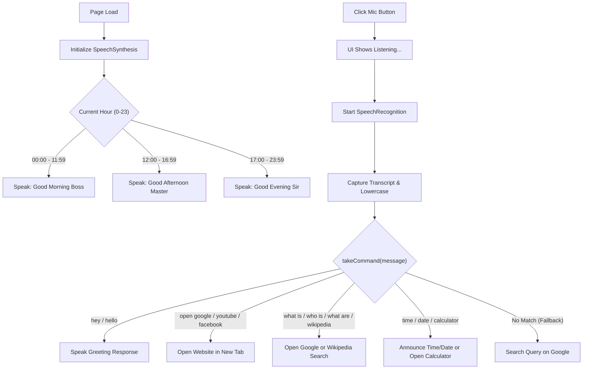
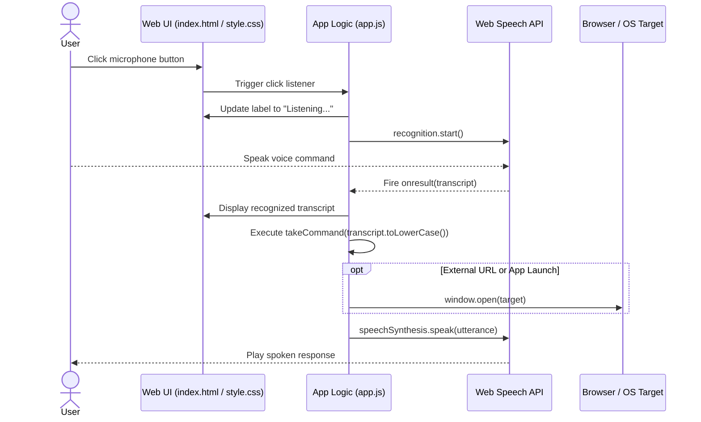

<div align="left">

# RAM — Virtual Assistant


</div>

---

## Overview

**RAM** is a browser-based virtual assistant that listens to spoken commands via the Web Speech API (`SpeechRecognition`) and responds audibly using `SpeechSynthesis`. It handles time-aware greetings, quick website launches, Google and Wikipedia queries, date/time announcements, and system calculator access through a dark-themed interface.

---

## Features

| Capability | Description |
| :--- | :--- |
| **Voice Recognition** | Captures spoken input on microphone click via `SpeechRecognition` / `webkitSpeechRecognition` |
| **Speech Synthesis** | Speaks confirmations, answers, time, and date back using `SpeechSynthesisUtterance` |
| **Time-Aware Greetings** | Automatically greets the user on page load based on the current hour |
| **Quick Site Navigation** | Opens Google, YouTube, and Facebook directly in new browser tabs |
| **Web & Wiki Search** | Queries Google (`what is`, `who is`, `what are`, or fallback) and Wikipedia (`wikipedia`) |
| **Built-in Utilities** | Announces local time and date, and launches the OS calculator (`Calculator:///`) |
| **Responsive Dark UI** | Minimalist `#000` canvas with `#00BCD4` accent, animated centerpiece, and `Roboto Mono` typography |

---

## Architecture & Workflow

### Voice Command Routing



### Runtime Interaction Sequence



<details>
<summary><strong>Startup &amp; Time-Based Greeting Rules (<code>wishMe()</code>)</strong></summary>

On page `load`, [`app.js`](app.js) speaks `"Initializing JARVIS..."` and runs `wishMe()` using the local system hour:

| Time Window (24-Hour) | Condition | Period | Spoken Greeting |
| :--- | :--- | :--- | :--- |
| `00:00` – `11:59` | `hour >= 0 && hour < 12` | Morning | `"Good Morning Boss..."` |
| `12:00` – `16:59` | `hour >= 12 && hour < 17` | Afternoon | `"Good Afternoon Master..."` |
| `17:00` – `23:59` | `else` (`hour >= 17`) | Evening | `"Good Evening Sir..."` |

</details>

---

## Supported Commands

| Category | Voice Trigger | Action Performed | Spoken Feedback |
| :--- | :--- | :--- | :--- |
| **Greeting** | `"Hey"` or `"Hello"` | Acknowledges greeting | `"Hello Sir, How May I Help You?"` |
| **Quick Launch** | `"Open Google"` | Opens `https://google.com` in a new tab | `"Opening Google..."` |
| **Quick Launch** | `"Open YouTube"` | Opens `https://youtube.com` in a new tab | `"Opening Youtube..."` |
| **Quick Launch** | `"Open Facebook"` | Opens `https://facebook.com` in a new tab | `"Opening Facebook..."` |
| **Web Search** | `"What is [query]"` / `"Who is [query]"` / `"What are [query]"` | Opens Google Search for the spoken query | `"This is what I found on the internet regarding [message]"` |
| **Knowledge Base** | `"Wikipedia [topic]"` | Opens `https://en.wikipedia.org/wiki/[topic]` | `"This is what I found on Wikipedia regarding [message]"` |
| **Date & Time** | `"Time"` | Reads local time (`hour`, `minute`) | `"The current time is [time]"` |
| **Date & Time** | `"Date"` | Reads current date (`month: short`, `day: numeric`) | `"Today's date is [date]"` |
| **System Utility** | `"Calculator"` | Opens `Calculator:///` URI scheme | `"Opening Calculator"` |
| **Fallback** | Any unrecognized phrase | Searches the phrase on Google in a new tab | `"I found some information for [message] on Google"` |

---

## Tech Stack

### Core Web Stack

| Layer | Technology | Version / Spec | Purpose | Source |
| :--- | :--- | :--- | :--- | :--- |
| **Markup** | HTML5 | HTML5 | Page structure, favicon, and microphone input UI | [`index.html`](index.html) |
| **Styling** | CSS3 | CSS3 | Dark `#000` background, `#00BCD4` theme, Flexbox layout | [`style.css`](style.css) |
| **Logic** | JavaScript | ES6+ | Event handling, date/time formatting, command routing | [`app.js`](app.js) |
| **Voice API** | Web Speech API | `SpeechRecognition` & `SpeechSynthesis` | Speech-to-text capture and text-to-speech playback (`rate: 1`, `volume: 1`, `pitch: 1`) | [`app.js`](app.js) |
| **Icons** | Font Awesome | `5.15.3` | Microphone button icon (`fas fa-microphone-alt`) via CDN | [`index.html`](index.html) |
| **Typography** | Google Fonts | `Roboto Mono` (`100`–`700`) | Monospace font family loaded via `@import` | [`style.css`](style.css) |

### Legacy Audio & ML Dependencies (`requirements.txt`)

> [!NOTE]
> [`requirements.txt`](requirements.txt) lists Python audio and deep-learning packages from an earlier/legacy setup; they are **not** required to run the browser-based assistant in [`index.html`](index.html).

<details>
<summary><strong>View <code>requirements.txt</code> Package Classification</strong></summary>

| Package | Version Constraint | Category | Typical Role |
| :--- | :--- | :--- | :--- |
| `torch` | `>=1.7.0` | Deep Learning | Tensor computation & neural network models |
| `numpy` | Unpinned | Numerical Computing | Array operations & math |
| `scipy` | Unpinned | Scientific Computing | Signal processing & scientific routines |
| `librosa` | Unpinned | Audio Analysis | Feature extraction & spectrogram analysis |
| `soundfile` | Unpinned | Audio I/O | Reading and writing audio files |
| `pydub` | Unpinned | Audio Manipulation | Audio slicing, conversion, and playback helpers |
| `tqdm` | Unpinned | CLI Utility | Progress bars for batch/training loops |

</details>

---

## Requirements & Compatibility

| Requirement | Specification | Notes |
| :--- | :--- | :--- |
| **Web Browser** | Chrome, Edge, or Safari | Requires `SpeechRecognition` / `webkitSpeechRecognition` and `speechSynthesis` support |
| **Microphone** | Active audio input device | Browser microphone permission must be allowed when prompted |
| **Internet Access** | Required | Loads Font Awesome & Google Fonts CDNs and opens external search tabs |

> [!TIP]
> For best speech recognition accuracy, use a quiet environment and speak clearly after the prompt displays `Listening...`.

---

## Installation & Usage

### Quick Start

1. **Clone the repository:**
   ```bash
   git clone https://github.com/madhanmohanreddyperam06/RAM.git
   cd RAM
   ```
2. **Launch the assistant:**
   Open [`index.html`](index.html) directly in a supported browser (or serve the folder with a local static server).
3. **Interact via voice:**
   - Click the microphone button (`Click here to speak`).
   - Grant microphone access if prompted.
   - Speak any command from the [Supported Commands](#supported-commands) table.

<details>
<summary><strong>Troubleshooting &amp; Browser Notes</strong></summary>

- **No voice recognition response:** Check that your browser supports `window.SpeechRecognition` or `window.webkitSpeechRecognition` (Chromium-based browsers like Chrome and Edge provide the most consistent support).
- **No spoken audio on page load:** Some browsers block `speechSynthesis` audio until a user gesture occurs; click the microphone button to trigger active voice interaction.
- **`Calculator` command does nothing:** `Calculator:///` relies on OS URI scheme support (available by default on Windows).

</details>

---

## Project Structure

| File | Type | Description |
| :--- | :--- | :--- |
| [`index.html`](index.html) | HTML5 | Entry page structure, Font Awesome CDN, visual container, and mic button |
| [`style.css`](style.css) | CSS3 | Dark-mode layout (`#000`), `#00bcd4` title styling, and pill input container |
| [`app.js`](app.js) | JavaScript | Startup greetings, speech recognition/synthesis hooks, and `takeCommand()` router |
| [`75lD.gif`](75lD.gif) | GIF Asset | Animated visual displayed in the main interface |
| [`ai-logo-design-vector.jpg`](ai-logo-design-vector.jpg) | Image Asset | Application favicon |
| [`requirements.txt`](requirements.txt) | Pip Spec | Legacy Python audio/ML dependencies (unused by the web runtime) |
| [`LICENSE`](LICENSE) | Legal | MIT License |
| [`README.md`](README.md) | Documentation | Project documentation |

<details>
<summary><strong>Preview Visual Assets</strong></summary>

| Asset | Preview | Usage |
| :--- | :---: | :--- |
| `ai-logo-design-vector.jpg` |  | Favicon (`index.html`) |
| `75lD.gif` |  | Main interface visual (`index.html`) |

</details>

---

## License

This project is licensed under the **MIT License** — see the [`LICENSE`](LICENSE) file for details.

---

## Contact Information

### Madhan Mohan Reddy

- **Email**: <madhanmohanreddyperam06@gmail.com>
- **Mobile**: +91 9110395993

---
<div align="center">
© 2026 RAM. All rights reserved.
</div>
